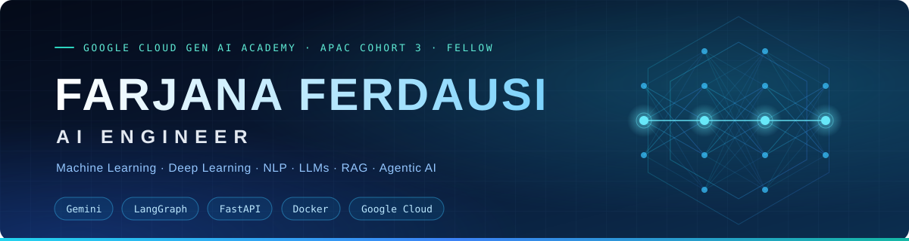

### AI/ML Engineer | Machine Learning, Deep Learning, NLP, LLMs, RAG & Agentic AI Systems

**Google Cloud Gen AI Academy APAC Edition (Cohort 3), Fellow** · Dinajpur, Bangladesh

[

---

## ⚡ Summary

AI/ML Engineer building grounded, cloud-deployed LLM systems: RAG assistants, multi-agent workflows, data agents and computer-vision services using Python, Gemini, LangChain, LangGraph, FastAPI, Docker and Google Cloud. Google Cloud Gen AI Academy APAC (Cohort 3) Fellow with 26 skill badges and 6 AI applications deployed on Cloud Run. Former HR professional with 14+ years of experience, bringing disciplined documentation, interview coordination, reporting and stakeholder communication to AI/ML engineering. Seeking AI/ML Engineer roles owning systems from prototype to deployment.

| 🚀 **6** | 🏅 **26** | 🧭 **3** | 🕰️ **14+** |
|:---:|:---:|:---:|:---:|
| AI apps on Cloud Run | Google Cloud skill badges | Gen AI Academy tracks | Years in HR |

## 🧠 Technical Skills

| Area | Stack |
|:--|:--|
| **Languages & Data** | `Python` (pandas, NumPy, Matplotlib, Pydantic) · `SQL` · `REST APIs` · `Data pipelines / ETL` |
| **Machine Learning** | `scikit-learn` · supervised and unsupervised learning · feature engineering · cross-validation · model evaluation |
| **Deep Learning, NLP & CV** | `PyTorch` · `TensorFlow` · `Keras` · `Hugging Face Transformers` · BERT fine-tuning · embeddings · `OpenCV` · `YOLOv8` · `YOLOv11` · object tracking (Deep SORT) |
| **LLMs & Generative AI** | `RAG` · hybrid retrieval (BM25 + embeddings) · `ChromaDB` · prompt engineering · structured outputs · tool calling · `MCP` · multi-agent systems · `Gemini` · `LangChain` · `LangGraph` · `CrewAI` · `Google ADK` · `LangSmith` · `n8n` |
| **MLOps & Cloud** | `Docker` · `FastAPI` · `Git` · `CI/CD` · Google Cloud (`Vertex AI`, `Cloud Run`, `BigQuery`, `IAM`, `Secret Manager`) · `Firebase` (Auth, Firestore) · Google Maps Platform · Google Earth Engine · `Render` · `Vercel` |

## 🛰️ Experience

**AI/ML Engineer, Freelance** · TR Enterprise (Start-up), Technology Division, Remote · *1 Sep 2026 – Present*
- Design, build and deploy cloud-hosted RAG chatbots, computer-vision services and data-analysis agents using Gemini, Google ADK, LangChain, LangGraph, BigQuery, FastAPI and Docker, owning the ML lifecycle from prototype to deployment.
- Containerize FastAPI services with Docker and ship them to Google Cloud Run.
- Enforce safeguards in AI workflows: least-privilege IAM, read-only SQL with dry-run validation, and human approval before any write action.

**Participant & Team Leader** · Google Cloud AI Builder Cup 2026, Hack2skill · *Sep 2026 – Present*
- Leading the team "TR AI Builders" in the Sustainability & Social Impact challenge; built and submitted OmniClean AI, deployed on Google Cloud Run.
- Shortlist announcement: 9 Nov 2026 · Grand finale: Singapore, 4 Dec 2026.

**AI/ML Engineering Fellow** · Google Cloud Gen AI Academy APAC Edition (Cohort 3) · *1 Aug 2026 – 30 Sep 2026*
- Completed all three tracks plus Meet the Builders and the Ideathon; received the Fellow certificate in Sep 2026.
- Delivered 5 AI applications on Google Cloud Run: RAG Barista agent, BigQuery MCP data agent, AI Coffee Manager, Flood Risk Assistant Bangladesh and AI/ML Learning Journal.

**Artificial Intelligence Intern** · CodeAlpha, India (Remote) · *20 Jul 2026 – 20 Aug 2026*
- Delivered 4 end-to-end AI projects: a 20-language voice translator, a TF-IDF/cosine-similarity FAQ chatbot, an LSTM Bach chorale generator, and YOLOv8 & Deep SORT object tracking.
- Shipped each as a documented, runnable GitHub repository; received a Letter of Recommendation.

<b>Earlier experience</b> · Career Break & Continuous Learning, HR Coordinator

 

**Career Break & Continuous Learning** · Self-directed, Bangladesh · *4 Oct 2020 – Feb 2026*

Planned, self-directed transition from HR to AI/ML engineering through structured, certified learning.
- Upskilled in HR: two Alison diplomas (Modern HRM, 2022; Human Resources, 2023) and three certificates (International & Strategic HRM; HR Policies & Organization Structure; HR in Food Service & Hospitality; 2022).
- Built GenAI foundations: AI Content Creation Bootcamp (Batch 82) and FB & YT Monetization (Batch 83), SR Dream IT, May – Jul 2025; Generative AI Mastermind (Outskill, completed twice: May 2025 and Jun 2026); Introduction to AI (Alison, 2026).
- Communication: continuous English development, Keith Speaking Academy (2 Oct 2023 – Present), covering IELTS Speaking GOLD Interactive, Fluent Grammar, Vocabulary Vault and Idioms courses.

**HR Coordinator** · Radisson Blu Dhaka Water Garden, Dhaka, Bangladesh · *15 Mar 2006 – 3 Oct 2020*
- Screened resumes and candidates, scheduled and conducted interviews, and coordinated joining formalities.
- Administered leave and daily time and attendance through the HRIS, tracking late arrivals, early departures and absenteeism.
- Maintained employee files and HR records for 400+ employees with 100% documentation compliance; built Excel headcount and attrition reports.
- Coordinated employee engagement and fundraising events; recognized with the Women's Loyalty Award (2018) and multiple Radisson Diamond, Platinum and Gold Awards.

## 🔬 Projects

### 1 · OmniClean AI: Waste Intelligence Platform
*Sustainable and Social Impact · AI Builder Cup 2026, Google Cloud & Hack2skill (Hackathon) · 1 Oct 2026 – 18 Oct 2026*
- Built an AI waste-intelligence platform that identifies items in a photo with Gemini, gives sorting guidance in English and Bengali, blocks recycling advice for hazardous items (batteries, chemicals, sharps, pressurized cans) and flags scans below 0.6 confidence for retake.
- Added an impact dashboard (recycling rate, estimated CO₂e avoided using EPA WARM v15 factors, 7-day trend) and a garment-factory monitor with a waste-per-1,000-pieces KPI and anomaly detection (> mean + 2σ) across 5 departments.
- Streamed analytics into 4 date-partitioned BigQuery tables using parameterized SQL and Application Default Credentials (no keys in source); kept the Gemini key server-side with a 4-model fallback ladder; deployed on Google Cloud Run.

`Gemini` `Vertex AI` `React` `TypeScript` `Express` `Firebase` `Firestore` `BigQuery` `Cloud Run`

 

### 2 · ESBC-AI: Easy Service for Bangladeshi Citizens
*Ostad Institute, Capstone Project (Module 27) · 19 Oct 2026 – 28 Oct 2026*
- Built a bilingual (Bangla and English) RAG assistant giving citation-grounded answers on passport, NID, birth and death registration, fees, tax and social allowances, using only official .gov.bd pages stored with source URL and verification date.
- Curated a 29-document knowledge base across 7 service areas; designed hybrid retrieval (Gemini embeddings + BM25, reciprocal rank fusion) with ChromaDB and a LangGraph agent with a confidence gate (0.45 threshold) plus a NO_ANSWER refusal protocol.
- Evaluated on a fixed 29-question bilingual set (keyword-based): 100% top-5 retrieval hit rate, 100% answer accuracy and 100% correct refusal on out-of-scope questions; offline pytest suite covers retrieval, API contract and refusal path.
- Served via FastAPI with Gemini model fallback and response caching; containerized with Docker and deployed on Render (API) and Vercel (frontend).

`Python` `FastAPI` `LangGraph` `RAG` `Gemini embeddings` `BM25` `ChromaDB` `Docker` `Render` `Vercel`

 

### 3 · AI/ML Learning & Career Journal
*Google Cloud Gen AI Academy APAC Edition (Cohort 3), Ideathon · 22 Aug 2026 – 6 Sep 2026*
- Developed an authenticated web app with multi-turn Gemini coaching, 7-part structured session summaries and a searchable timeline across four learning programs; added weak-skill detection, career-gap analysis and trend analysis over past sessions.
- Integrated Google Maps Platform (Places search, geolocation) for study-location tagging; secured data with Firebase Auth, owner-bound Firestore rules and Secret Manager (Gemini and Maps keys); deployed on Cloud Run.

`Gemini API` `React` `Node.js` `Express` `Firebase Auth` `Firestore` `Google Maps Platform` `Secret Manager` `Cloud Run`

 

> More projects, articles and certificates: **[Live Portfolio](https://farjanaferdausi-cs50ai.github.io/Farjana-Ferdausi-Resume/)**

## 🎓 Education & Training

| Program | Institution | Period |
|:--|:--|:--|
| AI & ML Engineer Bootcamp, Batch 6 | Ostad, Bangladesh | 18 Feb 2026 – Present |
| AI Engineering & Data Science Bootcamp 4.0 | Codebasics, India | 22 Jul 2026 – Present |
| M.A., English Language & Literature (CGPA 3.52 / 4.00) | Bangladesh University | 2013 – 2014 |
| B.A., English Language & Literature (CGPA 3.25 / 4.00) | International Business Administration and Information System University | 2008 – 2012 |

## 🏆 Certifications

- **Google Cloud Gen AI Academy, APAC Edition (Cohort 3), Fellow**, Hack2skill & Google Cloud, Sep 2026 (ID 2026H2S09GCGENAIAPACC3-P00697)
- **Google Cloud Skills Boost**, 26 skill badges (2026), including Gemini for App Developers, MLOps for Generative AI, Model Armor, Responsible AI, Introduction to AI Agents and Attention Mechanism
- **CodeAlpha Artificial Intelligence Internship**, with Letter of Recommendation, Aug 2026 (ID CA/DF1/205038)
- **Generative AI Mastermind**, Outskill, May 2025 & Jun 2026 (completed twice) · **Advanced Prompt Engineering**, Simplilearn, 2026
- **Python for Data Science & ML**, UniAthena, 2026 · **Introduction to Artificial Intelligence**, Alison, Feb 2026 (ID 25255027)
- **Human Resources**, Alison: Diploma in HR (Nov 2023), Diploma in Modern HRM (Jun 2022) and three short HR courses (2022)

## 🤝 Volunteering & Leadership

- **SOS Children's Village** · HR Team Representative, Radisson Blu · 2016 – 2020: visited about once every two months to donate food, clothes, soap and funds, support the children's education and spend time with them.
- **Crisis Management Team Member** · Radisson Blu · Aug 2015 – Oct 2020: supported emergency preparedness; CPR and First Aid certified by Bangladesh Red Crescent Society (2009, refresher 2011); Fire and Safety trained with annual refreshers (2007–2019).
- **Social Committee Member** · Radisson Blu · Dec 2015 – Oct 2020: organized engagement activities and fundraising for relief.
- **Employee Child Care Center Supervisor** · Radisson Blu · Oct 2009 – Oct 2020: managed budget, hygiene inspections and daily activities for children aged 0–5.

## 📡 Contact

📍 Dinajpur, Bangladesh · 📧 [farjana.rafi1983@gmail.com](mailto:farjana.rafi1983@gmail.com) · 📞 +880 1675-466770
🔗 [LinkedIn](https://www.linkedin.com/in/farjana-ferdausi/) · 💻 [GitHub](https://github.com/farjanaferdausi-cs50ai) · ✍️ [Medium](https://medium.com/@farjana.rafi1983) · 🌐 [Portfolio](https://farjanaferdausi-cs50ai.github.io/Farjana-Ferdausi-Resume/)

*Building AI that shows its evidence before it answers.*

